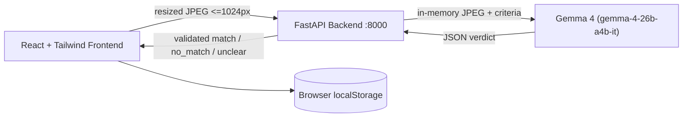

# StreetQuest AI — Outdoor Treasure Hunt

> A calm, minimal outdoor treasure hunt game powered by **Gemma 4** (`gemma-4-26b-a4b-it`) via the Gemini API.
> Built for the **Hacktoberfest 2026 DEV Open-Source AI Challenge**, Week 1 "Touch Grass".
> Hashtags: `#devchallenge` `#weekendchallenge` `#hf26challenge`

---

## 🍃 Overview

StreetQuest encourages players to step outside and observe natural details around them:
1. **Choose a level**: Easy (always open), Medium (unlocks after 2 Easy missions), or Hard (unlocks after 2 Medium missions).
2. **Accept a mission**: 9 missions total, from finding living leaves to discovering natural patterns.
3. **Capture a photo**: Uploaded directly from mobile or desktop with automated canvas resizing ($\le 1024\text{px}$).
4. **AI Photo Check**: The backend verifies the photo using **Gemma 4 26B** in memory without ever writing user photos to disk.
5. **Score & Ranks**: Earn points for valid matches (`Seedling` $\rightarrow$ `Trail Finder` $\rightarrow$ `Ranger` $\rightarrow$ `Pathfinder`).

---

## 🏛 Architecture



---

## 🔒 Privacy & Rules

- **Photo Check Only**: The app provides automated photo checks, never proof of physical location.
- **In-Memory Processing**: Uploaded images are processed strictly in RAM and never written to disk or logged.
- **No Personal Identifiers**: Photos containing prominent people are rejected with `no_match`.
- **API Key Security**: The Gemini API key stays solely in `backend/.env` and is never exposed to the frontend or git.

---

## 🚀 Getting Started

### Prerequisites
- Node.js 18+
- Python 3.10+

### 1. Backend Setup
```bash
# Navigate to project root
# Create virtual environment (if not already created)
python -m venv backend/.venv

# Activate virtual environment (Windows PowerShell)
.\backend\.venv\Scripts\Activate.ps1

# Install requirements
pip install -r backend/requirements.txt

# Configure your environment in backend/.env:
# GEMINI_API_KEY=your_key_here
# GEMMA_MODEL=gemma-4-26b-a4b-it
# PORT=8000

# Start backend server
python -m uvicorn main:app --app-dir backend --port 8000 --reload
```

Health check: verify `http://localhost:8000/health` returns `{"status":"ok"}`.

### 2. Frontend Setup
```bash
# Install frontend dependencies
npm install

# Start Vite dev server
npm run dev
```

Open [http://localhost:5173](http://localhost:5173) in your browser.

---

## 🧪 Testing the AI Model

Verify Gemma 4 model connectivity and image understanding:
```bash
.\backend\.venv\Scripts\python backend\test_model.py
```

---

## 📊 Mission Details

| ID | Level | Title | Points | Time | Criteria |
|---|---|---|---|---|---|
| `easy-1` | Easy | Something green | 10 | ~2 min | A close-up of a living green leaf. |
| `easy-2` | Easy | Look up | 10 | ~2 min | A photo where sky fills at least half the frame. |
| `easy-3` | Easy | Round things | 10 | ~2 min | A clearly round pebble, fruit, or flower head. |
| `med-1` | Medium | Heart shape | 20 | ~4 min | An object or natural shape resembling a heart. |
| `med-2` | Medium | Tiny life | 20 | ~4 min | A small insect, spider, snail, or bird. |
| `med-3` | Medium | Two textures | 20 | ~4 min | Two distinctly different natural textures (e.g., bark & moss). |
| `hard-1` | Hard | Unusual leaf | 30 | ~6 min | A leaf with an atypical shape, coloration, or insect notch. |
| `hard-2` | Hard | Pattern in nature | 30 | ~6 min | A repeating natural pattern (e.g., ripples, pinecone, frond). |
| `hard-3` | Hard | Shadow art | 30 | ~6 min | A shadow forming a distinct, interesting shape. |
